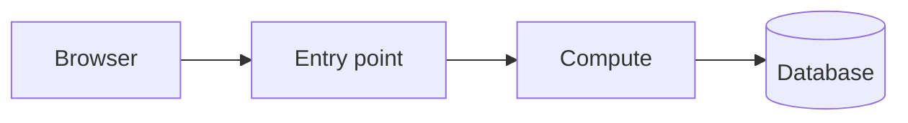

# Melon Market - Backend Developer Assignment

Welcome, and thank you for your time. This assignment is part of the interview process.
It is designed to show us how you read, review, fix, extend and explain real code, which is what a
backend developer on our team does every day.

- Suggested time box: **about 4 hours**. The scope is larger than the time box on purpose. Prioritise,
  and tell us in the review what you skipped and why. A focused, well-explained partial result is better
  than a rushed complete one.
- You may use any tools you normally use (documentation, search, an AI assistant). You must be able to
  explain and defend every line you submit.
- Everything runs locally in Docker. **You do not need an AWS account** and you must not create AWS resources.

## What you will do

| # | Task | Output |
|---|------|--------|
| 1 | Code review of the existing code base | `REVIEW.md` |
| 2 | Investigate and fix three reported problems | Code changes in git, short notes in `NOTES.md` |
| 3 | Add a new API endpoint | Code, tests, documentation |
| 4 | Describe how you would run this system on AWS | Diagram and trade-offs in `AWS.md` |

After you submit, we meet for one **45-minute review session** (agenda at the end of this document).

---

## 1. Product overview and specification

Melon Market is a small online shop that sells watermelons. Shoppers browse the catalog and ask for a price
quote (there is no real checkout yet). An administrator maintains the catalog.

The text in this section is the intended behaviour of the system. Treat it as the reference when you review
and fix the code.

### 1.1 Architecture (local)

```
                 http://localhost:8080
                          |
                 +--------v---------+
                 |  gateway (nginx) |   plays the role of a load balancer
                 +--+------+-----+--+
   /api/catalog/*    |      |     |   /          and  /admin
         +-----------+      |     +------------> static web UI (shopper + admin pages)
         |                  | /api/admin/*
+--------v-------+   +------v-------+
| catalog (public)|  | admin (JWT)  |        FastAPI services (Python, asyncpg)
+---+--------+----+  +------+-------+
    |        |              |
    |        | HTTP         |
    |  +-----v------+       |
    |  | rates-mock |       |   fake third-party exchange-rate provider (do not modify)
    |  +------------+       |
+---v-----------------------v---+
|        PostgreSQL 16          |   one database, two roles: catalog_ro (read only), admin_rw (read/write)
+-------------------------------+
```

| Component | Folder | Purpose |
|-----------|--------|---------|
| gateway | `gateway/`, `web/` | nginx. Routes `/api/catalog/*` and `/api/admin/*` to the services, serves the web pages |
| catalog | `services/catalog/` | Public, read-only API for shoppers: list items, quote |
| admin | `services/admin/` | JWT-protected API for the shop owner: add, remove, change price and quantity |
| rates-mock | `services/rates-mock/` | Stand-in for an external exchange-rate provider. See its own README. Do not modify it |
| postgres | `db/migrations/` | Schema, roles and seed data, applied by the one-shot `migrate` service |

### 1.2 How to run

Requirements: Docker with the Compose plugin. Nothing else.

```bash
cp .env.example .env          # development placeholders only
docker compose up --build -d
docker compose ps             # all services should be Up; "migrate" exits with code 0 when done
```

| What | URL |
|------|-----|
| Shopper web page | http://localhost:8080/ |
| Admin web page | http://localhost:8080/admin (user `admin`, password from `.env`) |
| Catalog API docs (Swagger) | http://localhost:8080/api/catalog/docs |
| Admin API docs (Swagger) | http://localhost:8080/api/admin/docs |
| Direct service ports (localhost only) | catalog `8001`, admin `8002`, rates-mock `8003` |

If one of these host ports is taken on your machine, change it in `.env` (`GATEWAY_PORT`, `CATALOG_PORT`, ...).

Useful commands:

```bash
docker compose logs -f catalog admin          # follow logs
docker compose exec postgres psql -U postgres -d melon     # database shell (password in .env)
docker compose down                           # stop
docker compose down -v                        # stop and delete the database volume (fresh start)

# run the unit tests of a service inside Docker
docker compose run --rm --no-deps catalog python -m pytest -q
docker compose run --rm --no-deps admin python -m pytest -q
```

The unit tests use in-memory fakes and do not need the database.

### 1.3 Seed data

| id | name | weight (kg) | price (ILS) | stock | notes |
|----|------|-------------|-------------|-------|-------|
| 1 | Crimson Sweet | 8.00 | 24.90 | 120 | |
| 2 | Sugar Baby | 3.00 | 14.50 | 60 | |
| 3 | Yellow Doll | 4.00 | 19.90 | 25 | |
| 4 | Seedless Jubilee | 10.00 | 32.00 | 0 | out of stock |
| 5 | Crimson Sweet - Half | 4.00 | 14.94 | 30 | half item of id 1 |
| 6 | Moon and Stars | 6.00 | 21.00 | 10 | removed from sale (not active) |

### 1.4 General rules

- All amounts are in **ILS** unless stated otherwise. Money is exact decimal arithmetic. In JSON, money is a
  **string with exactly two decimals** (for example `"74.70"`), never a floating point number.
- Errors have one shape, with an HTTP status that matches the problem:
  `{"error": {"code": "<machine_code>", "message": "<human text>"}}`
- A removed item is never shown to shoppers, never quoted and cannot be changed. Removal is a soft delete:
  the row stays in the database with `is_active = false`.
- A **half item** is a separate item (own id, own stock) that belongs to a whole item through `half_of`.
  Its price is always **60% of the whole item's price, rounded half up to the cent**. The price of a half item
  can not be set directly. When the price of a whole item changes, the price of its active half items changes
  with it.
- Secrets (passwords, signing keys) are never written to logs, never returned by an API and never committed.
- The catalog service has read-only access to the database. Only the admin service writes.
- Services must keep responding to unrelated requests while an external dependency is slow or failing.

### 1.5 Catalog service (public, no authentication)

`GET /api/catalog/items`

Returns the active items ordered by `id`:

```json
[
  {
    "id": 1,
    "name": "Crimson Sweet",
    "description": "classic striped, sweet and juicy",
    "weight_kg": "8.00",
    "price": "24.90",
    "currency": "ILS",
    "quantity": 120,
    "availability": "in_stock",
    "approx_usd": "6.72"
  }
]
```

- `availability` is `in_stock` when `quantity > 0`, otherwise `out_of_stock`.
- `approx_usd` is an informational price in USD (price times the current rate, rounded half up to the cent). It is
  `null` when the rates provider cannot be reached. The list itself must still be returned.

`GET /api/catalog/items/{id}`

One active item in the same shape (`approx_usd` is `null`). `404` with code `not_found` for an unknown or removed item.

`POST /api/catalog/quote`

Request:

```json
{"items": [{"item_id": 1, "quantity": 3}]}
```

- `items` has 1 to 50 lines, `item_id` > 0, `quantity` from 1 to 1000. Lines with the same `item_id` are merged.
- Response `200`:

```json
{
  "currency": "ILS",
  "lines": [
    {"item_id": 1, "name": "Crimson Sweet", "unit_price": "24.90", "quantity": 3, "line_total": "74.70"}
  ],
  "total": "74.70"
}
```

- `422` with code `unknown_item` if an item does not exist or has been removed.
- `422` with code `insufficient_stock` if the requested quantity is **more than** the stock. Ordering exactly the
  number in stock is allowed.
- A quote does not change stock.
- Malformed input returns `422` with code `validation_error`.

`GET /health` returns `{"status": "ok"}`.

### 1.6 Admin service (JWT)

All endpoints except `login` and `health` require `Authorization: Bearer <token>`. Missing or invalid token: `401`
with code `unauthorized`.

`POST /api/admin/login`

Request `{"username": "admin", "password": "..."}`. Response `{"access_token": "...", "token_type": "bearer",
"expires_in": 28800}`. A token is valid for `JWT_EXPIRE_MINUTES` minutes (default 480) and not longer. Wrong
credentials: `401`.

`GET /api/admin/items?sort=<field>`

All items, including removed ones (`is_active: false`). `sort` is one of `id` (default), `name`, `price`,
`quantity`. Any other value is a `422`.

`POST /api/admin/items`

- Whole item: `{"name": "Mini Melon", "weight_kg": "2.00", "price": "9.90", "quantity": 5}` (`description` is optional).
  `201` with the created item.
- Half item: `{"half_of": 3, "quantity": 5}`. Name defaults to `"<whole name> - Half"`, weight to half of the whole
  item, and the price is derived (see 1.4). `price` must not be sent. `half_of` must reference an active whole item,
  otherwise `422 invalid_half_of`.
- Two active items can not have the same name (case-insensitive): `409 duplicate_name`.

`PATCH /api/admin/items/{id}/price`

Body `{"price": "16.90"}`. Price must be greater than zero with at most two decimals. A half item's price can not be
changed directly: `409 price_is_derived`. Active half items of the changed whole item are repriced.

`PATCH /api/admin/items/{id}/quantity`

Body is **either** `{"delta": -3}` (relative change) **or** `{"quantity": 40}` (absolute value), never both.
Stock is never negative: a change that would result in a negative quantity is rejected with `422 negative_stock`
and nothing is changed. Concurrent adjustments must all be applied: two requests that each subtract 1 from 10
must leave 8.

`DELETE /api/admin/items/{id}`

Soft delete, `204`. Requires authentication. An item that still has an active half item can not be removed:
`409 has_half_item`.

Every successful change (create, price, quantity, remove) writes one row to `audit_log` with the acting
administrator's username.

### 1.7 Rates mock (external dependency)

`GET /rates?base=ILS` returns `{"base": "ILS", "rates": {"USD": "0.27", "EUR": "0.25"}, "as_of": "..."}`.
Like most third-party APIs it is slow or unavailable some of the time. Read `services/rates-mock/README.md`.
It has a switch to make its behaviour deterministic while you develop.

---

## 2. Task 1 - Code review (about 60 to 75 minutes)

Pretend a teammate opened a pull request that contains this whole repository, and you are the reviewer.
Read the code, the Docker setup and the database migrations, and compare them with the specification above.

Write `REVIEW.md` with the findings you consider worth raising. For each finding give:

- where it is (file and line or function),
- what is wrong and what could happen because of it,
- a severity (critical, high, medium, low) and a short justification,
- how you would fix it.

Order the findings by importance. You do not have to fix everything you find in Task 1; fixing happens in Task 2
for the reported problems. We care about the quality of your judgement more than about the number of findings:
tell us what you would block the PR for and what you would leave as a follow-up.

## 3. Task 2 - Fix reported problems (about 90 minutes)

The following issue reports arrived from the people who use the system. Each one describes symptoms only. For each
report: reproduce it, find the root cause (there may be more than one), fix it, and add or improve a test that would
have caught it. Keep the fixes small and in separate commits with clear messages.

**Report A - from customer support**

> Several customers complained about the shop. One said the total for three Crimson Sweet watermelons showed up as a
> number with a long tail of digits. Another wanted all the Yellow Doll watermelons we show as available and was told
> that there was not enough stock. Last week a partner who calls our API from a script also managed to get a price for
> the heirloom "Moon and Stars", which we stopped selling.

**Report B - from the store manager**

> I use the admin page every morning. Yesterday my colleague and I counted stock at the same time and entered a lot of
> small corrections, and afterwards the numbers did not add up. Also, I once reduced the stock of Seedless Jubilee by
> too much and the page then showed me a negative number. And when I created a half Yellow Doll, the price looked one
> agora lower than 60% of the whole melon.

**Report C - from operations**

> Twice this week the whole shop froze for roughly half a minute for every visitor, including pages that have nothing to
> do with currency. After we recreated the environment from scratch, the first minute was full of errors and some
> containers restarted several times before things settled. And while reviewing the audit log, we found a removed item
> that was removed by "admin" at a time when nobody had logged in to the admin page.

Write a few lines per report in `NOTES.md`: what you found, root cause, how you verified the fix, and anything you
chose not to fix.

## 4. Task 3 - Add a new API (about 45 to 60 minutes)

Shoppers abroad want to see their quote in another currency. Add to the **catalog** service:

`POST /api/catalog/quote/converted`

Request:

```json
{"items": [{"item_id": 1, "quantity": 2}], "currency": "USD"}
```

- `currency` is `USD` or `EUR`. Anything else is a `422 validation_error`.
- The items are validated and priced exactly like `POST /api/catalog/quote`.
- Exchange rates come from the rates provider (`GET /rates?base=ILS`). Use the rates-mock service as it is.
- The response contains the ILS quote, the converted amounts, the rate that was used and the time of the rate
  (`as_of`). Choose and document a sensible response shape. Money rules from 1.4 apply.
- The provider is unreliable. Decide what the endpoint should do when it is slow or failing, implement it, and be ready
  to explain the trade-off. The service must stay responsive for other requests.
- Add unit tests, document the endpoint in this README (a short section is enough) and show it works through the
  gateway (`curl` example in your notes).
- Optional: use the new endpoint in the shopper page.

## 5. Task 4 - AWS architecture (about 30 minutes)

Today everything runs in Docker Compose. We runs workloads on AWS, so we would like to see how you would host this
system there. Create `AWS.md` with:

1. A diagram of the production environment (Mermaid in a code block is fine, an image is fine too). Include networking,
   compute, data, secrets, the entry point, the external rates provider, and how the code gets from git to production.
2. The most important decisions and trade-offs, in half a page: why these services, what you would do differently for a
   very small budget versus a high-traffic launch, how you handle secrets, backups, observability and failure of a single
   Availability Zone.
3. What you would change in this repository to make it ready for that environment.

You do not build any of it. The diagram below is only an example of the expected format, it is not the expected design:



## 6. Deliverables checklist

- [ ] A git repository (zip it together with the `.git` folder, or share a private repository link) with your commits on
      top of the starting commit.
- [ ] `REVIEW.md` - Task 1
- [ ] Fixes for Task 2 with tests, and `NOTES.md`
- [ ] Task 3 endpoint with tests and documentation
- [ ] `AWS.md` - Task 4
- [ ] `docker compose up --build -d` works from a clean checkout after `cp .env.example .env`, and the unit tests pass
- [ ] A few lines at the top of `NOTES.md`: what you did not have time for, and what you would do next

Please do not push your work to a public repository.

## 7. The 45-minute review session

You will present your work to two engineers in a single session. Everything is open for questions, so please
be ready to open your editor and the running system.

| Time | Topic |
|------|-------|
| 0 - 5 min | Your overview: what you did, how you split your time, what you skipped |
| 5 - 15 min | Code review: your most important findings in `REVIEW.md`, and what you would block a merge for |
| 15 - 27 min | Fixes: walk through two or three of your fixes, how you found the cause, how you tested it |
| 27 - 35 min | The new API: design choices, behaviour when the rates provider fails, tests |
| 35 - 42 min | AWS design and security: your diagram, trade-offs, secrets, networking, what you would harden first |
| 42 - 45 min | Your questions for us |

We are interested in how you think, how you prioritise, and how clearly you explain your choices. "I would not do it this
way, and here is why" is a perfectly good thing to say about code that was given to you.

Good luck, and enjoy the melons.
